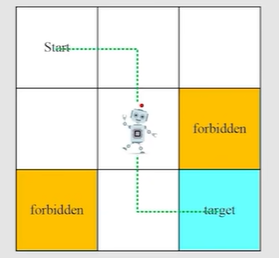
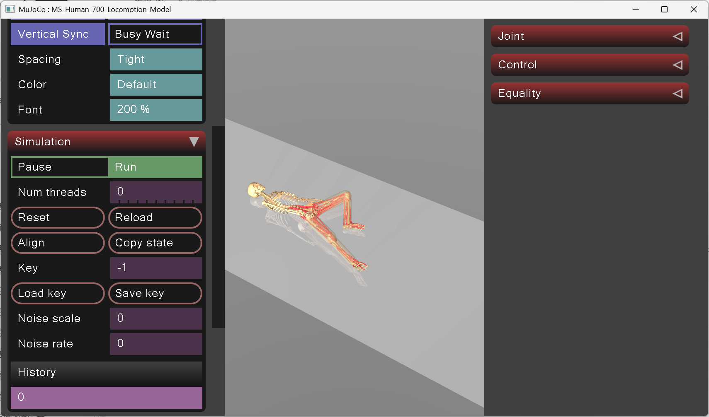
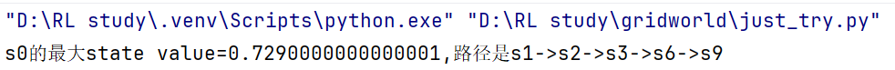
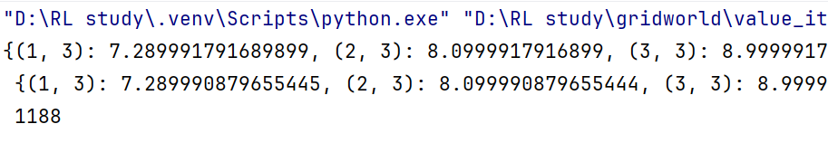
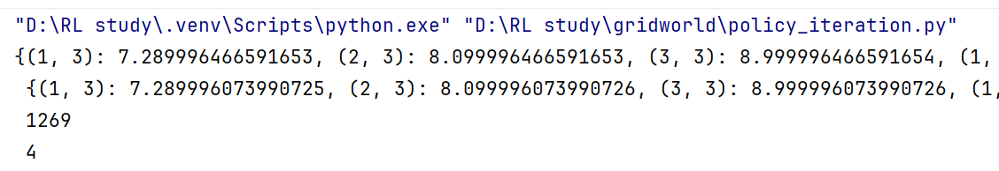
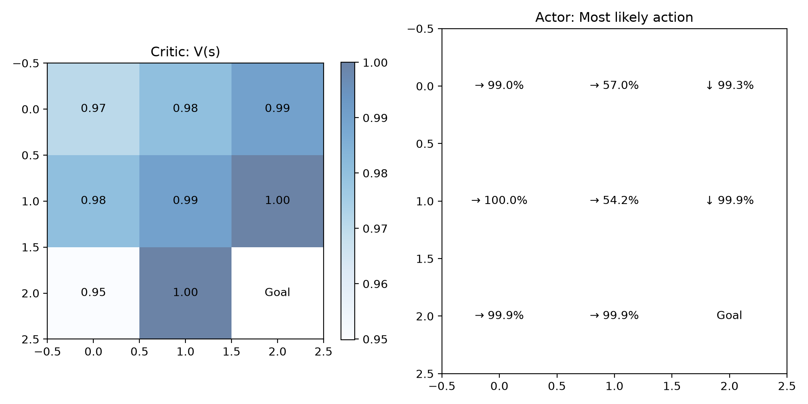
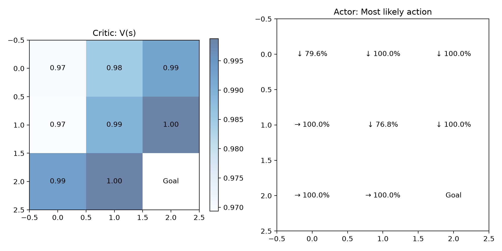
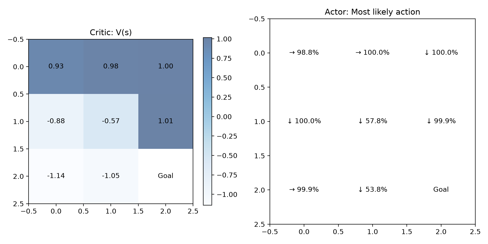
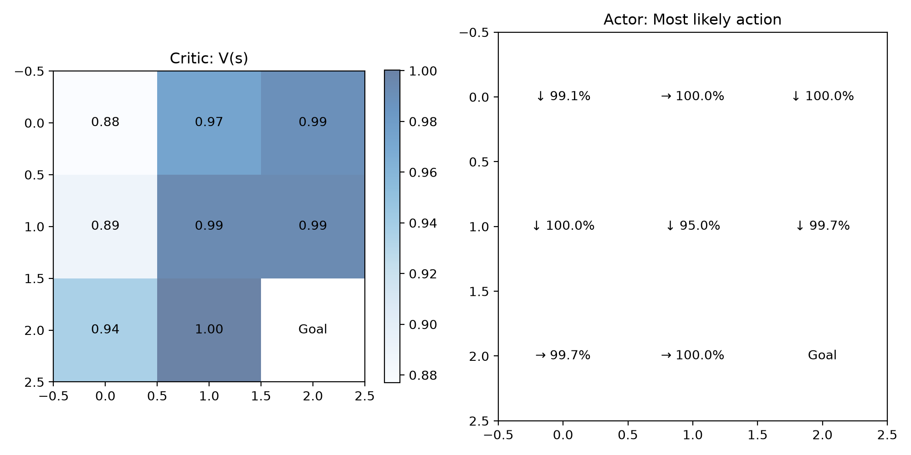

# 这是我的强化学习仓库

## 阶段总结

由于目前系统性学习的主要是西湖大学的强化学习课程，我实践落实了它里面的例子网格世界



我先在3×3网格世界里实现值迭代和策略迭代，再用Gymnasium封装环境，通过Stable-Baselines3的PPO训练智能体。通过学习CartPole跑通训练和评估流程的例子，在自己的 GridWorld上迁移修改观察策略、检查失败轨迹，并尝试调整起点、撞墙惩罚和回合步数上限。

---

目前的学习进度：

- 西湖大学《强化学习的数学原理》第 1–4 章
  - 基础概念
  - 贝尔曼公式
  - 贝尔曼最优公式
  - 值迭代与策略迭代
- Python代码
  - Gymnasium使用
  - PPO初步应用
- Mujoco
  - 下载了`MS-Human-700`



之后打算看看代码的资料，比如强化学习的系统性代码练习

---

## 代码顺序

| 阶段  | 文件                                      | 内容                                                                                                |
| --- | --------------------------------------- |---------------------------------------------------------------------------------------------------|
| 1   | `gridworld/return_random.py`            | 随机走一条路，回报是多少，主要是把网课抽象的东西落到代码上面                                                                    |
| 2   | `gridworld/The_world.py`                | 为了方便之后的代码，把世界设定单独抽出来作为模块                                                                          |
| 3   | `gridworld/just_try.py`                 | 纯暴力乱找多次尝试，多次运行结果相同，认为找到了最优路径                                                                      |
| 4   | `gridworld/value_iteration.py`          | 写了一个值迭代的代码，在后面验证了值迭代的有效性                                                                          |
| 5   | `gridworld/policy_iteration.py`         | 策略迭代，返回总次数和策略迭代次数                                                                                 |
| 6   | `gym_gridworld/gridworld_env.py`        | 初步接触gym，尝试让之前写的网格世界根据[Env - Gymnasium 文档 - Gymnasium 文档](https://gymnasium.org.cn/api/env/)变成标准环境 |
| 7   | `gym_gridworld/grid_try.py`             | 调用自己写的环境，让他走了指定的一条路，反馈和调用没有问题                                                                     |
| 8   | `gym_gridworld/grid_try_fail.py`        | 试图用环境写一个值迭代，但是用环境写不是很支持值迭代所需的动作和反馈，强行写太麻烦，最后放弃去看PPO了，这是环境的标准用法                                    |
| 9   | `gym_basics/train_cartpole.py`          | 先拿别人的环境跑通的流程看看怎么用                                                                                 |
| 10  | `gym_gridworld/gridworld_random_env.py` | 根据需求扩写了之前的那个环境，并添加了许多可以修改的值，使得调用的时候有更多可选                                                          |
| 11  | `gym_gridworld/PPO_gridworld.py`        | 让 PPO 自己学习最优路径，可视化了结果                                                                             |

---

## 快速复现

已有实验使用 Windows、Python 3.13.9、Gymnasium 1.4.0、Stable-Baselines3 2.9.2 和 PyTorch 2.15.0（CPU）。在仓库根目录运行以下 PowerShell 命令。

```powershell
py -3.13 -m venv .venv
$python = '.\.venv\Scripts\python.exe'
& $python -m pip install -r requirements.txt

& $python gridworld/just_try.py
& $python gridworld/value_iteration.py
& $python gridworld/policy_iteration.py
& $python gym_gridworld/PPO_gridworld.py
```

随机轨迹搜索会打印本轮抽到的最佳路径和折扣回报，两个迭代脚本会打印状态价值。GridWorld PPO 脚本会打印每个格子的动作概率和状态价值，并把新生成的图和模型写到当前目录下的 `results/`。下文链接指向已有的实验图，保存在 `gym_gridworld/results/`。

## 网课代码

最开始，我用已知的Python知识尝试定义边界惩罚，折扣因子，状态集合，运动规则 **(the_world)**，并用他们算出了一个随机10步路径的return（**return_random**）

### 随机走1000次  just_try

我当时还没有学到值迭代和策略迭代，于是按照自己的想法，多次随机找最大值。

一开始的办法比较直接。每次从`s1`出发，上、右、下、左、不动这五个action随机选一个。走到 `s9` 就结束这条轨迹，没走到就最多试1000步。每条轨迹都算一个折扣return，最后从1000条里面挑回报最大的那条。



最后多次测试，得到的结果都是0.729，于是我认定找到了最优路径。数字很好解释，按照这个路径，前三步没有撞墙也没有踩陷阱，reward 都是 0。第 4 步到终点拿到+1。按笔记里写的，第几步拿到 reward，折扣指数就是步数减一。这里 $\gamma=0.9$，所以

```math
G_0 = 0 + \gamma \cdot 0 + \gamma^2 \cdot 0 + \gamma^3 \cdot 1 = 0.9^3 = 0.729.
```

### 值迭代 value_iteration

我对视频里面讲的值迭代不是很清楚，于是自己按照原理写了一个代码

他会不断迭代，直到这次迭代的值与上一次差值小于一定程度才行，输出该轮，上一轮的值和总迭代次数



之前的随机采样一到`s9`就会break，值迭代和之后的策略迭代到了`s9`还可以一直选不动，每步拿 +1，直到每个state value收敛才会终止循环。在不断的$\gamma$乘算下，算出来就是

```math
v_*(s_1) = \gamma^3 + \gamma^4 + \gamma^5 + \cdots = \frac{\gamma^3}{1-\gamma} = 7.29.
```

这个值也和第一章笔记里面7.1Discounted return的结论一致（如果不设置终止，需要引入$\gamma$），相比随机采样的0.729，差的那个10倍就是这里的 $1/(1-\gamma)$

### 策略迭代 policy_iteration

相比值迭代，策略迭代的思路是很清晰踏实的，就是找到每一个策略下精确的state value,根据这个精确值寻找最好的策略，再把这个策略拿去迭代。

有意思的是，根据网课老师和弹幕所说，虽然策略迭代多了一个迭代，但是在总轮数上是优于值迭代的。



但是从结果上来看，相比值迭代更新了1188个state value，策略迭代需要1269次state更新，两者的收敛要求都是`max(abs(v[k] - v_old[k]) for k in v)<1e-6`，也就是相差不超过1e-6。

也就是说，在这个例子上面，策略迭代的计算量更大，速度是不如值迭代的。可能是因为多了对策略收敛的要求？

## GridWorld PPO

一开始不是很了解这个所谓的环境是什么，于是读文档里面的gym说明手册，配合ai把之前写的那个网格世界设定（**the_world**）改写为Gym框架下的env类（**gridworld_env**）,并写了一个跑指定路线的测试代码（**grid_try**）。

之后尝试写一个值迭代（**grid_try_fail**），但是发现在使用环境的情况下不好写，于是顺着文档去学习适配环境的算法PPO。随后模仿别人的其他环境训练（**train_cartpole**），写了一个自己的网格世界PPO训练代码（**PPO_gridworld**）

### 为什么加入随机起点 gridworld_random_env



按照设定，陷阱格是左下角，发现策略对了，但是值是错误的

由于每次起点固定从左上角出发，策略学会绕开陷阱后，训练轨迹可能很少覆盖陷阱格。

于是我加入了随机起点，让训练回合可以从任意非终点格开始，包括陷阱格。这样就增加了进入陷阱的概率，得到了比较好的结果



### 种子问题

b站网课说过有可能策略会选择穿过陷阱达到目标，我想实践一下，在环境里面增加陷阱格内容后，我尝试把陷阱放到中间，第一次训练的配置和之前一样，使用 `seed=0`、撞墙惩罚为`−1`。

但是从`s1`出发,给出的结果非常诡异。



底行中间的 `s8` 把向下撞墙排在第一（**53.8%**），向右到终点排在第二（**45.6%**），而且大量的格子state value明显不对，甚至有超过1的值

### 对比种子、撞墙惩罚与步数上限

我最初怀疑撞墙和踩陷阱同罚`−1`会影响让神经网络分不清，于是尝试换种子、加重撞墙惩罚。下表使用保存的策略逐格检查，从每个非终点格出发，每步选择概率最高的动作。结果表示能到终点的起点数。

|           环境设置           | `seed=0` | `seed=1` | `seed=2` |
| :----------------------: | -------: | -------: | -------: |
|      撞墙惩罚 `−1`，原配置       |      4/8 |      8/8 |      8/8 |
|        撞墙惩罚 `−5`         |      8/8 |      8/8 |        — |
|        撞墙惩罚 `−10`        |      8/8 |      8/8 |        — |
| 撞墙惩罚 `−1`，`max_steps=20` |      8/8 |        — |        — |

同样用 `−1` 的撞墙惩罚，换成 `seed=1` 或 `2` 后，八个起点都能到终点。`seed=1` 在 `s8` 仍接近五五开，向右以 **53.8%** 成为第一选择。保留 `seed=0`、把撞墙惩罚设成 `−5` 或 `−10` 的存档也都通过了逐格检查。结果说明相同的边界和陷阱惩罚设置也能学到可到达的策略。

如果不是奖励问题，那就有可能是种子问题，可能比较倒霉，第一个种子seed=0刚好不匹配我这个代码，于是尝试换3个种子，发现结果除了seed=0都是正常的，说明种子问题确实是主要问题。

### 对PPO加深理解

所以为什么会出现训练失败呢？

我认为撞墙和陷阱的惩罚一样是一个重要原因，当增大撞墙惩罚后结果就对了，说明一样的惩罚让神经网络判断失误。

按照我对PPO的理解，critic预测的是当前actor下的值，而actor又是根据critic和真实值比较来进化，如果critic在一开始的actor下默认了错误的值为正确的，那么actor就会认为获得-1的动作是正确的，继续走-1，导致获得惩罚的概率被放大了，反过来促进critic认为错误值的正确性，这就成了一个死循环。如果能提前结束，缩减后面越来越糟的策略，应该能减小问题

把回合上限设为 `20`后重新训练，其他的保持一致： 3×3 网格、随机起点、中央陷阱 `s5`（代码下标 `4`）、陷阱和撞墙奖励均为 `−1`、终点奖励 `+1`



`seed=0` 模型从八个起点都能到终点，提前结束的代价就是远离终点的格子，左上角那三个并没有完全收敛到正确的state value,但是`s8` 的策略和state value都没有了问题。

换种子就没问题，可能是他们的起始actor和critic没有像seed=0那样极端，没陷在错误反馈循环里面
