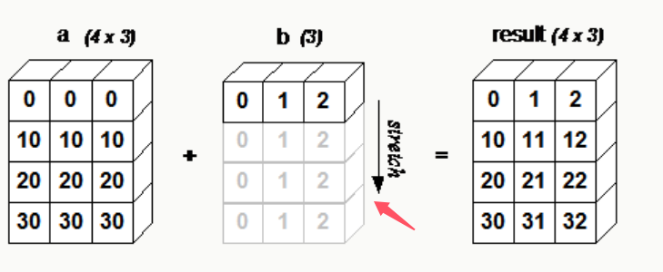

NumPy是Python中基于数组对象的科学计算库。它是Python语言的一个扩展程序库，支持大量的维度数组与矩阵运算，以及大量的数学函数库。
NumPy的核心是ndarray对象，它是一个功能强大的N维数组对象，封装了n维同类数组。

这是定义ndarray的方法
	`numpy.array(object, dtype = None, copy = True, order = None, subok = False, ndmin = 0)`
		`numpy.array(数组或嵌套的数列, dtype =元素的数据类型, copy = 对象是否需要复制, order =控制的是内存排列方式, subok = 默认返回一个与基类类型一致的数组, ndmin =指定生成数组的最小维度)`

# 数组特性
数组ndarray作为一个类，有其属性
NumPy 数组的维度数量称为==秩（ndim）==，秩就是轴的数量，即数组的维度
	`[[1,2],[3,4],[5,6]]`数组有两个轴，维度数量为 2，即 `ndim=2`
	可以认为维度数量就是嵌套层数，从最外层往里数，**要剥几层方括号才能拿到单个数字**，就是几维
数组的每一个维度称为一个==轴（axis）==，也就是维度（dimensions），其中第 0 轴相当于是最外层数组的方向，第 1 轴是内层数组的方向，以此类推，对二维数组而言，axis=0 表示沿着第 0 轴进行操作，即对每一列进行操作；axis=1 表示沿着第 1 轴进行操作，即对每一行进行操作。`axis`沿指定轴，把这个轴上的多个值汇总起来
	二维数组可以理解为按照先每个列表的第一个数字垂直往下列（axis=0），然后按水平排开其他的数字（在axis=1方向上遍历）,==先行再列==，行是最先固定的，根据元素数量，然后才是元素里面的元素，也就是列数。axis=0意味着对先每个列表同下标（垂直方向，axis=0）进行处理，然后水平移动（axis=1）进行继续，结果就是垂直方向（axis=0）被压平了。这不表示必须按照某个先后顺序遍历数组，只是方便理解，以下是二维数组的构建简略理解
	`[1,]`       `[1,2]`
	`[3,]`--->`[3,4]`
	`[5,]`       `[5,6]`
一维数组的形状是（x,）,不是（x,1），第二个是`[[1],[2]]`
## ndarray 对象属性

|      对象属性       |                   描述                    |                      说明                       |
| :-------------: | :-------------------------------------: | :-------------------------------------------: |
| `ndarray.ndim`  |        数组的秩（rank），即数组的维度数量或轴的数量         | 相当于嵌套了几层，`[[a,c],[a,b]]`，是两个，每多一个列表套列表，就多一个维度 |
| `ndarray.shape` |           数组的形状，表示数组在每个轴上的大小            |       就是每个嵌套里面有几个元素，对于二维数组（矩阵），表示其行数和列数       |
| `ndarray.size`  | 数组中元素的总个数，等于 `ndarray.shape` 中各个轴上大小的乘积 |      第一个列表有3个，第二个有4个，每个里面还有2个，就是`3*4*2`       |

# 创建ndarray
最基础的是直接从普通的python列表/元组来创建
	`a=np.array([1,2,3])`

|                   函数名称                   |                       描述                        |                               示例                               |
| :--------------------------------------: | :---------------------------------------------: | :------------------------------------------------------------: |
|   `numpy.empty(shape, dtype = float)`    |       建一个指定形状（shape）、数据类型（dtype）且未初始化的数组        |         `x = np.empty([3,2], dtype = int)`里面的数字是未初始化的值         |
|   `numpy.zeros(shape, dtype = float)`    |              创建指定大小的数组，数组元素以 0 来填充              | `y = np.zeros((5,), dtype = int)`默认为浮点数<br>`(5,)`表示一个长度为5的一维数组 |
|     `numpy.ones(shape, dtype = None)`     |              创建指定形状的数组，数组元素以 1 来填充              |                    `x = np.ones(5)`，默认为浮点数                     |
|     `numpy.asarray(a, dtype = None)`     |    可作为数字的数据：列表, 列表的元组, 元组, 元组的元组, 元组的列表，多维数组    |                `x = [1,2,3]; a = np.asarray(x)`                |
| `numpy.arange(start, stop, step, dtype)` | 根据 start 与 stop 指定的范围以及 step 设定的步长，生成一个 ndarray |            `x = np.arange(5)`<br>`--->[0 1 2 3 4]`             |

# 索引、切片和条件筛选
ndarray对象的内容可以通过索引或切片来访问和修改，与 Python 中 list 的切片操作基本一样,而且语法基本一样
## 索引：取一个值或一整行
按照列表嵌套的方法可以取得具体值或者某一个列表（一整行）
二维数组取某个值：`data[行下标, 列下标]`；`data[行下标][列下标]` 也可以，只是多一次索引
## 切片：取某个范围
切片和 Python 列表一样，**左闭右开**
行和列可以分别指定范围:
	`data[:, 0]`     所有行，第0列：所有奖励
	`data[:, 1] `    所有行，第1列：所有步数
	`data[:2, 0] `  前两行，第0列

可以理解为这是一个索引，在二维数组中，逗号前面是对第0维度处理，也就是行，语法的和正常的切片没有区别，逗号后面则是对下一个维度进行处理，第1维度也就是列
每一个逗号之间是单独的一个切片，在这里面对对应的列表进行选取。如果选取的是切片，则保留这个维度，如果是==单个整数==，则将他们全部合并为一个保存了对应整数索引对应数据的数组，原维度消失，也就是降维了。==切片参数出现整数则降维==
如果有多个维度，只写了不到所有维度的切取，剩下的默认按顺序全取：`[1:]`=`[1:,:]`
## 布尔筛选：取出满足条件的记录
用布尔值作掩码，布尔索引通过布尔运算（如：比较运算符）来获取符合指定条件的元素的数组
在`[x>5]`这样的操作会形成一个与`x`一个形状的，用`False`和`True`填充的数组，x可以以切片形式出现
`x[x>5]`会产生一个留下满足条件的一个一维数组，无论几维
可以用以下联合起来删选

| 写法   | 含义       |
| ---- | -------- |
| `&`  | 两个条件都满足  |
| `\|` | 至少满足一个条件 |
| `~`  | 条件取反     |

`r2=metrics[(metrics[:,0]>0) & (metrics[:,1]<20),]`
如果想要保留某一维度，则需固定其他维度（=0），该行完整取，形成一个与该维度等长的掩码
先想想这个掩码怎么求出来，然后放到对应切片的位置上
比如想要判断第二列是否大于0，则需要`[:,1]>0`，然后放到行上面去取

# 广播
广播(Broadcast)是 numpy 对不同形状的数组进行数值计算的方式， 对数组的算术运算通常在相应的元素上进行
形状相同时，对应位置分别计算，很好理解`[1,1,1]+[2,2,2]=[3,3,3]`,`[2,2,2]**2=[4,4,4]`
当形状不同时，numpy将触发广播机制
- 让所有输入数组都向其中形状最长的数组看齐，形状中不足的部分都通过在前面加 1 补齐，所以输出数组的形状是输入数组形状的各个维度上的最大值
	注意，是往前补，一个(3,)的长度为三的一维数组补成（1，3）的二维数组，不是（3，1）的一列
- 对每个维度进行对比，如果输入数组的某个维度和输出数组的对应维度的长度相同，则逐元素对应计算
- 或者其长度为 1 时，对其兼容，比如（1，3）匹配（3，3），则沿着大的维度复制小维度上的第一组值，（1，3）重复三次为（3，3），但实际上不复制内存。广播是运算时的匹配规则，不会改变原数组的形状。


# 修改数组形状
可以用-1代替一个值，但是剩下的形状参数必须要能推出来

|         函数名称         |                   描述                    |                       示例                       |
| :------------------: | :-------------------------------------: | :--------------------------------------------: |
|   `numpy.ravel()`    |    多维数组**拉平**成一维数组，按行优先顺序（C 顺序）排列元素     | `np.array([[1,2],[3,4]]).ravel() = [1,2,3,4]` |
| `numpy.reshape(a,b)` | 把相同的元素重新组织成另一种形状，先按行依次读取原来的数字，再按新形状逐行填入 |       上面这些调用不会改变原来的 `a.shape`，它返回一个新的数组        |
|      `numpy.T`       |   将二维数组行列互换；一维数组的 `.T` 不变   | `[[1,2],--> [[1,3],`<br>`[3,4]]`      `[2,4]]` |
| `numpy.resize(a,b)`  |         返回新数组；尺寸变大时会循环重复填充。原地修改用 `ndarray.resize`         |                                                |

# **副本和视图**
与python相同，如果对指定地方赋值，修改的会是原数组
``` python
a = np.array([10, 20, 30])
b = a

b[0] = 99

print(a)  # [99 20 30]
```
但不同的是，numpy里面的切片不像python一样会新建数组，还是指向同一个对象
`a： [10, 20, 30, 40]`
       ` └──┬──┘`
`b：   [20, 30]`
可以这样理解，**NumPy 基本切片共享数据**
想要保留原数组，需要创建副本，也就是在赋值的时候在后面加一个.copy()
布尔筛选也是默认创建数组
``` python
a = np.array([10, 20, 30, 40])
b = a[a > 20]

b[0] = 99

print(b)  # [99 40]
print(a)  # [10 20 30 40]
```
但是不写b=的话就是对a进行操作
还有，如果对数组直接操作，也会生成新数组
b+=10不会产生副本，b=b+10这样就会产生新数组
# **矩阵乘法**
在numpy里面，正常的`*`不是传统意义上的矩阵乘法，而是对应元素相乘，如有必要，广播后返回一个同形状的列表
这边用@来表示矩阵乘法，也就是左边的行去乘以右边的列，返回相加值的列表
```python
a = np.array([
    [1, 2, 3],
    [4, 5, 6],
])

b = np.array([
    [10, 20],
    [30, 40],
    [50, 60],
])
c = a @ b

c=[[220 280]
 [490 640]]
```
**形状规则：中间相等，保留两边**
(2, 3) @ (3, 2)
`   └───┘
    必须相等
结果：(2, 2)