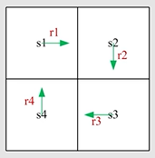
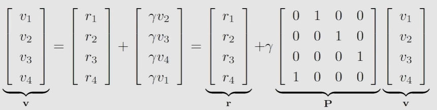
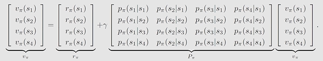
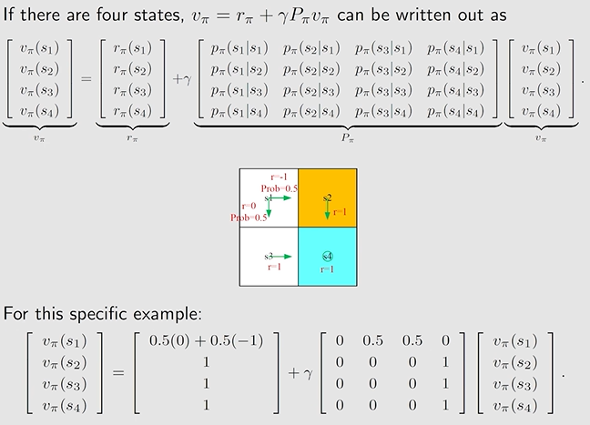

基础知识：当存在一条轨迹trajectory时，它路线上的奖励reward总和被称为return
我们需要有办法来区分哪个return是好的，哪个policy是好的，一个简便的方法就是比较return的值

怎么来计算return呢，一种是用定义
# 导入公式
首先定义$v_i$是从$s_i$出发，获得的return，我们的目的就变成了求出$v_i$。根据return定义，我们可以得到
$v_1=r_1+\gamma r_2+\gamma^2 r_3+...$
$v_2=r_2+\gamma r_3+\gamma^2 r_4+...$
$v_3=r_3+\gamma r_4+\gamma^2 r_1+...$
$v_4=r_4+\gamma r_1+\gamma^2 r_2+...$
观察后，可以写出一个迭代式
$v_1=r_1+\gamma v_2$
$v_2=r_2+\gamma v_3$
$v_3=r_3+\gamma v_4$
$v_4=r_4+\gamma v_1$
有了这个四元方程，我们该怎么求出具体的$v_i$值呢

用矩阵描述这个方程组，将$[\gamma v_2,\gamma v_3,\gamma v_4,\gamma v_1]^T$写为一个状态转移矩阵和$v_i$的乘积，这样就统一了要求的未知量
可以将它写作$$
\mathbf{v} = \mathbf{r} + \gamma \mathbf{P} \mathbf{v}
$$
这个就是贝尔曼公式在这个特定情况下的版本
其中r是对应的reward，p是一个由policy和state transition决定的矩阵
	从数学上看可以方程两边移项后矩阵求逆相乘来求vi，不过求逆有时计算量比较大，不常用
# State value 状态价值
$$
S_t \xrightarrow{A_t} R_{t+1}, S_{t+1}
$$先来一个最基础的单步过程，用时间t来区分，
这个式子描述了
- 当时间为t时，agent处在状态$S_t$
- 当处在状态$S_t$时，采取行动$A_t$
- 采取行动$A_t$后，获得奖励$R_{t+1}$
- 采取行动$A_t$后，移动到了$S_{t+1}$
假设我们已知MDP的几个集合
- 指定状态下采取行动的概率（策略Policy）$\pi(A_t=a|S_t=s)$
- 指定状态，行动获得奖励的概率(奖励概率R) $p(R_{t+1} = r | S_t = s, A_t = a)$
- 指定状态，行动移动转移的概率(移动转移概率S) $p(S_{t+1} = s' | S_t = s, A_t = a)$

拓展到多步的trajectory
$$
S_t \xrightarrow{A_t} R_{t+1}, S_{t+1} \xrightarrow{A_{t+1}} R_{t+2}, S_{t+2} \xrightarrow{A_{t+2}} R_{t+3}, \dots
$$
可以根据return定义求出return的简写$G_t$
$$
G_t = R_{t+1} + \gamma R_{t+2} + \gamma^2 R_{t+3} + \dots
$$
	可以发现和上面那个导入公式的区别就是变量更复杂了，小写代表的是具体的单个变量，这边大写表示是一个随机变量（概率描述），需要用期望来计算，也更正式，一般化
由此我们可以定义state value function(state value)：
$$
v_\pi(s) = \mathbb{E}[G_t | S_t = s]
$$
这是一个关于s的函数，它表示了在一个明确的策略$\pi$下，一个指定的状态的价值
	return指的是单个路线的reward总和，state value指的是从一个state出发，所有的p的return的平均期望，如果p只有一个，那么两者没有区别。
		这里的p指的是所有的概率，也就是上面Policy的概率和两个概率（$\pi(a|s)$，$p(r |s, a)$， $p(s'|s, a)$）不单指某一个。
# 贝尔曼公式 Bellman equation
贝尔曼公式描述了不同状态的价值之间的关系
将一般化的$G_t = R_{t+1} + \gamma R_{t+2} + \gamma^2 R_{t+3} + \dots$和之前的迭代式结合可以得到
$$G_t = R_{t+1} + \gamma G_{t+1}$$
也就是说，一个state的价值等于立刻能得到的reward加上衰减后下一个state的价值
将这个$g_t$的迭代式导入state value的式子可以得到
$$
\begin{aligned}
v_\pi(s) &= \mathbb{E}[G_t | S_t = s] \\
&= \mathbb{E}[R_{t+1} + \gamma G_{t+1} | S_t = s] \\
&= \mathbb{E}[R_{t+1} | S_t = s] + \gamma \mathbb{E}[G_{t+1} | S_t = s]
\end{aligned}
$$
由于期望可以分开，我们单独分析这两个
## 奖励
首先是从s出发，能获得的reward的期望平均值
	这里面没有涉及到移动到下一个的影响，所以概率主要是策略概率$\pi(a|s)$和奖励概率$p(r|s,a)$
由于有多个概率，使用全期望公式，先区分同一个s下，策略概率导致的不同行为
$$
\begin{aligned}
\mathbb{E}[R_{t+1} | S_t = s] &= \sum_{a} \pi(a|s) \mathbb{E}[R_{t+1} | S_t = s, A_t = a] 
\end{aligned}
$$
然后区分在同一个行动下，奖励概率导致的r不同
$$
\begin{aligned}
\mathbb{E}[R_{t+1} | S_t = s, A_t = a]
=\sum_{r} p(r|s, a)r
\end{aligned}
$$
结合起来就是
$$
\begin{aligned}
\mathbb{E}[R_{t+1} | S_t = s] &= \sum_{a} \pi(a|s) \mathbb{E}[R_{t+1} | S_t = s, A_t = a] \\
&= \sum_{a} \pi(a|s) \sum_{r} p(r|s, a)r
\end{aligned}
$$这就是奖励的展开式
## 下一个
然后是移动到的下一个state的平均价值
	概率主要是策略概率$\pi(a|s)$和状态转移概率$p(s'|s,a)$
首先区分不同目的地的影响
$$
\mathbb{E}[G_{t+1} | S_t = s] = \sum_{s'} \mathbb{E}[G_{t+1} | S_t = s, S_{t+1} = s'] p_\pi(s'|s)
$$
它表示了各目的地的后续期望回报，按到达概率加权求和，由于目的地$s'$已经知道了，不需要在关注从哪出发了，在马尔可夫环境中，后续持续采用同一个只依赖当前状态的策略。给定 $S_{t+1}$ 后，更早的状态不再影响后续回报的分布。所以去掉$S_t=s$，这样就简化为了
$$
\mathbb{E}[G_{t+1} | S_t = s] = \sum_{s'} \mathbb{E}[G_{t+1} | S_{t+1} = s'] p_\pi(s'|s)
$$式子中$\mathbb{E}[G_{t+1} | S_{t+1} = s']$表示了在$s'$下的state value，进一步简化为
$$
\mathbb{E}[G_{t+1} | S_t = s] = \sum_{s'} v_\pi(s') p_\pi(s'|s)
$$
由于所谓的**去往不同目的地的概率**我们并不知道，用已知的策略概率$\pi(a|s)$和状态转移概率$p(s'|s,a)$来表示出来，其实就是在指定策略下采取某一行动的概率乘以在该行动下去某一点的概率，得到结果
$$
\mathbb{E}[G_{t+1} | S_t = s]= \sum_{s'} v_\pi(s') \sum_{a} p(s'|s, a)\pi(a|s)
$$
## 结果
将上面的合并，提取公因式，可以得到$$
\begin{aligned}
v_\pi(s) &= \mathbb{E}[R_{t+1}|S_t = s] + \gamma \mathbb{E}[G_{t+1}|S_t = s], \\
&= \sum_{a} \pi(a|s) \sum_{r} p(r|s, a)r + \gamma \sum_{a} \pi(a|s) \sum_{s'} p(s'|s, a)v_\pi(s'), \\
&= \sum_{a} \pi(a|s) \left[ \sum_{r} p(r|s, a)r + \gamma \sum_{s'} p(s'|s, a)v_\pi(s') \right], \quad \forall s \in \mathcal{S}.
\end{aligned}
$$这个就是贝尔曼公式，由于概率已知，它描述了两个状态概率的关系，也就是一个$v_\pi(s)$和$v_\pi(s')$的关系式，它对于所有的状态$\forall s \in \mathcal{S}$都成立
可以看出，利用多个式子组可以求出每个状态的价值，其中作为影响因素的有
**dynamic model动态模型**，也就是环境的物理定律，$p(s'|s, a)$和$p(r|s, a)$，他们决定了动作a的结果
除去这两个，还有一个就是策略Policy，这个也是贝尔曼公式的重点，通过计算state value可以评价这个Policy的好坏
## 简化
$$\begin{aligned}
v_\pi(s) &= \mathbb{E}[R_{t+1}|S_t = s] + \gamma \mathbb{E}[G_{t+1}|S_t = s], \\
&= \sum_{a} \pi(a|s) \sum_{r} p(r|s, a)r + \gamma \sum_{a} \pi(a|s) \sum_{s'} p(s'|s, a)v_\pi(s')
\end{aligned}
$$不提取公因式，这里面的两项就是一开始分析的那两个
第一项是从s出发，能获得的reward的期望平均值，用$r_\pi(s)$来表示这个期望值
	$r_\pi(s)=\sum_{a} \pi(a|s) \sum_{r} p(r|s, a)r$
第二项是移动到的下一个state的平均价值，保留衰减系数$\gamma$和迭代需要的变量$v_\pi(s')$，剩下的用$p_\pi(s'|s)$来表示指定策略下到达不同目的地的概率
	$p_\pi(s'|s)=\sum_{a} \pi(a|s)p(s'|s, a)$
结果就是$$
v_\pi(s_i) = r_\pi(s_i) + \gamma \sum_{s_j} p_\pi(s_j|s_i)v_\pi(s_j)
$$用向量来写就是$$
v_\pi = r_\pi + \gamma P_\pi v_\pi
$$其中 
* $v_\pi = [v_\pi(s_1), \dots, v_\pi(s_n)]^T \in \mathbb{R}^n$
* $r_\pi = [r_\pi(s_1), \dots, r_\pi(s_n)]^T \in \mathbb{R}^n$
* $P_\pi \in \mathbb{R}^{n \times n}$，其中 $[P_\pi]_{ij} = p_\pi(s_j|s_i)$，是状态转移矩阵（state transition matrix）
回到最开始的例子

把里面的绿色箭头用概率写出来，就是一开始那个

这就是一个例子
## 求解
$$
v_\pi = r_\pi + \gamma P_\pi v_\pi
$$对于这个表达式，一般不求逆来算
用迭代法来求$$
v_{k+1} = r_\pi + \gamma P_\pi v_k
$$相比于一开始的，它的下标换成了k+1和k。理论上一开始那个下标都是$\pi$，只有一个变量，可以一步求出来，但是由于求逆太麻烦，我们采取用用上一轮（第 k 次）估算的价值 vk​，去更新这一轮（第k+1 次）的价值 vk+1
当k足够大的时候，由于$\gamma$<1，最终当vk+1和vk差距小到满足条件的时候，就算是收敛成功$v_\pi$

# action value 行动价值
state value指的是从这个state出发能获得的平均期望return
为了能更好确定policy中，每一个state采取什么action能获得更好价值，我们需要研究action value
action value指的是从一个state出发，采取一个行动获得的平均return  $$
q_\pi(s, a) = \mathbb{E}[G_t | S_t = s, A_t = a]
$$这个便是**动作价值函数**，指从状态s出发，第一步选择动作 \(a\)，此后遵循策略 $\pi$ 时的期望回报
根据他的定义，一个状态价值是各动作价值按策略概率加权的和，也就是$$
v_\pi(s)=\mathbb{E}[G_t | S_t = s] = \sum_{a} \mathbb{E}[G_t | S_t = s, A_t = a] \pi(a|s)
$$把动作价值函数带入就是$$
v_\pi(s) = \sum_{a} \pi(a|s) q_\pi(s, a)
$$它介绍了怎么从动作价值得到状态价值
和贝尔曼公式对比发现
$$
q_\pi(s, a) = \sum_{r} p(r|s, a)r + \gamma \sum_{s'} p(s'|s, a)v_\pi(s')
$$这个就是动作价值函数的**贝尔曼期望方程**，说明了怎么从状态价值怎么得到动作价值
